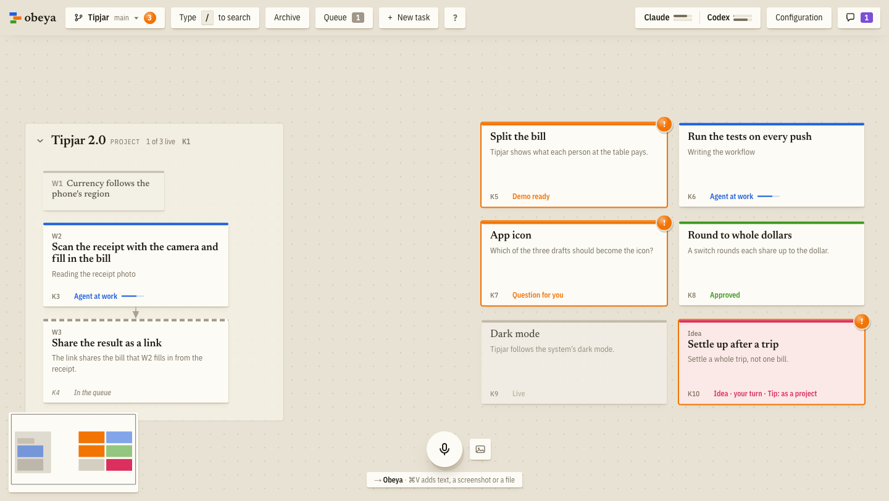
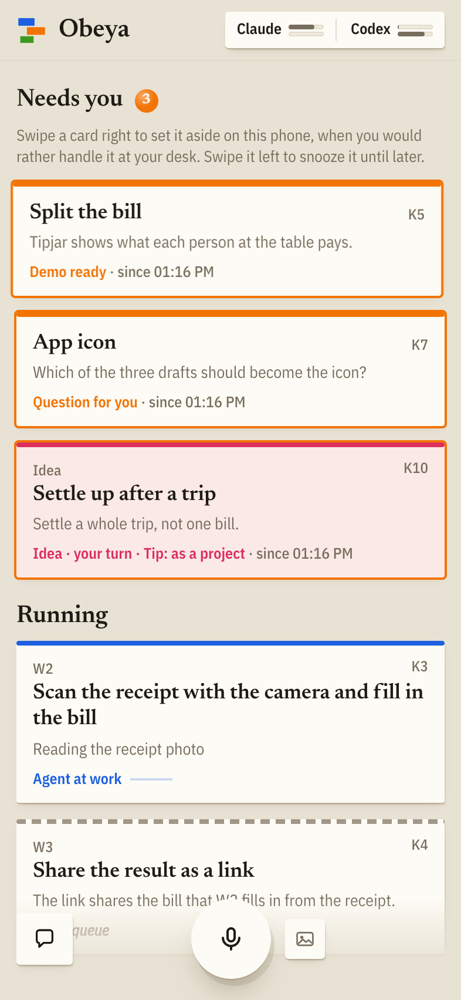
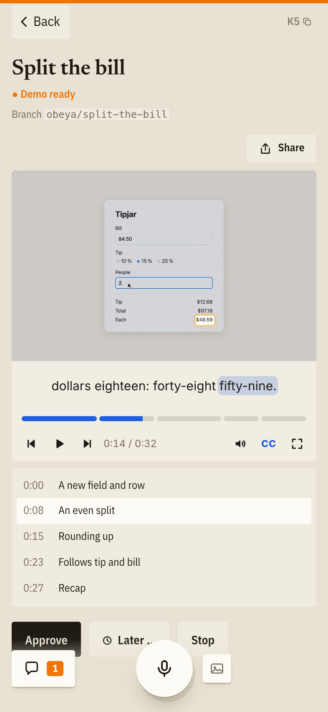

<h1>
  <picture>
    <source media="(prefers-color-scheme: dark)" srcset="src/ui/logo/wordmark-dark.svg">
    
  </picture>
</h1>

Obeya is a spatial workspace for directing AI coding agents the way an engineering director
directs a team. Every task and every project is a card on one canvas, and agents do the work in
the background. When an agent is done, it shows you a narrated demo. You approve it or say what to
change, by voice if you like. You don't read code or switch between terminals, and you can do all
of this at your desk or on your phone.

*Obeya* is Japanese for "big room". In lean management it is the room where a project's plans and
status hang on the walls. More on [obeya.si](https://obeya.si).

<a href="https://obeya.si/#film"></a>

The video shows Obeya at work in four and a half minutes. An idea is said into the microphone, an
agent builds it and records its demo, and the approval lands it on `main`. [Watch it on
obeya.si](https://obeya.si/#film) with captions and chapters.

See every feature in action on [demos.obeya.si](https://demos.obeya.si). Each change to Obeya is
listed there with the demo its agent recorded.

## How it works

Each card gets its own agent, Claude Code or Codex. The agent works in its own clone or worktree of
your repository, on this machine or on another one that Obeya reaches over SSH. When it needs a
decision, it asks on the card. When it is done, it hands over with a demo. Usually that is a
narrated screen recording of the change, or a silent one with subtitles in as many languages as
you like. When the result is a layout or several variants side by side, the demo is a page to look
at instead. A report or another file the agent made for you shows beside its conversation.

You approve the demo or say what to change. If your feedback is about one moment of the video,
pause it there and type or say it. The agent gets that frame and the narration's sentence along
with your words.

Approved work lands on `main` or goes out as a pull request on GitHub (GitHub Enterprise too),
Forgejo or Gitea (Codeberg, for example). Obeya looks after the pull request until it is merged.
Where your team merges itself, Obeya looks after it until it is ready to merge. Beside the branch,
the card shows how large the change is, and a click shows the diff. An approval given by mistake
can be taken back, even after the work landed: Obeya closes the pull request or reverts the change.

Give Obeya a branch of yours, or the link of your own pull request, and the task carries on there:
its work goes onto that pull request. In a fork, each task can also go to the original repository
as a pull request, while the fork keeps its own changes.

"Share" puts a demo on a page of its own on your repository's demo site, for colleagues to watch.
The site can also publish every approved demo without your click. If a repository has no demo
site, you share on a personal one, which Obeya sets up on GitHub Pages or Cloudflare with one
button.

Say "Review PR #14", and a pull request someone else opened gets a card. Its agent reads the diff
before any of that code runs on your machine, reviews it, and records a demo of the app before and
after the change. For each finding you choose what happens: it goes to the contributor, the agent
fixes it, it becomes a follow-up task, or you ignore it. You can edit the text that goes onto the
pull request, then click "Push and merge" or "Push and comment only". When it is the contributor's
turn, the card waits. Once they comment or push, the agent reviews the pull request again.

You talk to Obeya itself, spoken or typed. It takes your instructions, cuts large tasks into
packages that run in parallel, and learns your preferences. It queues cards whose changes would
collide, and an arrow you draw from one card to another makes the second wait for the first. Ask
Obeya how something works or what a change does, and it can answer with a short walkthrough of
slides and narration, which starts to play while Obeya is still writing it. "Show as walkthrough"
turns any of its text answers into one.

An idea gets a card and an agent of its own, and you think it through with that agent. The agent
keeps a brief of the variants and the open questions, and it can have throwaway prototypes built.
When you decide, Obeya builds the idea, in your repository or in a new one it creates, or plans it
as a project. You can also split off the part that is settled as a task while the rest stays open.

Larger work is planned in plan docs, in the repository or in a folder of your own beside it. Obeya
shows each plan doc as a project with a card per workstream and a project agent that answers
questions about the plan. Each product you build gets its own canvas, for one repository or
several, and one Obeya runs all of them.

You can pause and resume a card's agent, or all agents of a canvas from the canvas list. Each
agent finishes its current step first. Typing "/" in a card's field offers the skills its agent
knows. The bar shows how much of your plan's session and week is used, for Claude, for ChatGPT
(which Codex runs on), or for both. If you switch it on in Configuration, the bar also shows what
the agents cost, per card and per canvas. In "Agents and models" you choose which harness and
model each group of agents runs on. The menu beside a card's start button sets them for that card
alone. When Claude Code or Codex has an update, Obeya offers it at a click.



## On your phone

Away from your desk, your phone lists the cards that are waiting for you on all your canvases,
grouped by canvas, and the ones agents are working on. Watch a demo and approve it, answer a
question, or hold the microphone button and describe a new task. Swipe aside a card you would
rather handle at your desk, and it stays hidden until it needs you again. A notification tells you
when a card needs you.

<p>
  
  &nbsp;
  
</p>

Obeya keeps running on your computer, and your phone connects to it over your own private network,
Tailscale or another VPN. Nothing goes through our servers, and nothing is open to the internet.
[Connecting a phone](#connecting-a-phone) describes the setup.

## Status

Obeya is early, but in daily use. Obeya is built with Obeya, and it is also used to build
commercial software. The interface and the voice input work in English and German.
[`docs/design.md`](docs/design.md) describes how Obeya works and why.

## Download

| | |
|---|---|
| macOS | [Apple Silicon](https://github.com/sadilek/obeya/releases/latest/download/Obeya-macOS-arm64.dmg) · [Intel](https://github.com/sadilek/obeya/releases/latest/download/Obeya-macOS-x64.dmg) (DMG) |
| Windows | [Installer](https://github.com/sadilek/obeya/releases/latest/download/Obeya-Windows-x64-setup.exe) (x64) |
| Linux | AppImage for [x64](https://github.com/sadilek/obeya/releases/latest/download/Obeya-Linux-x86_64.AppImage) · [arm64](https://github.com/sadilek/obeya/releases/latest/download/Obeya-Linux-aarch64.AppImage), .deb for [x64](https://github.com/sadilek/obeya/releases/latest/download/obeya_amd64.deb) · [arm64](https://github.com/sadilek/obeya/releases/latest/download/obeya_arm64.deb) |

The app needs neither Bun nor a checkout. On its first start it checks the machine for what Obeya
needs ([Claude Code](https://claude.com/claude-code) or [Codex](https://developers.openai.com/codex/cli)
with your login, and git) and for what can wait (the [GitHub CLI](https://cli.github.com) for pull
requests, voice, demos). It installs what it can without admin rights and shows the command for
the rest. Then it opens your first canvas on one of your repositories.

The Windows installer is not signed yet. An application for signing at the SignPath Foundation is
pending ([code signing policy](https://obeya.si/code-signing/)). Until then SmartScreen warns about
the installer, and "More info" followed by "Run anyway" continues. On Linux, make the AppImage
executable (`chmod +x`) first.

The app keeps itself up to date. A new release shows in its bar. When you install it, the app
waits until the agents have paused and then restarts with the new version. A .deb is updated by
installing the next one.

On the canvas, double-click to write a task, then click "Start agent". The card shows what the
agent is doing. Cards that are waiting for you are counted in orange at the left of the bar and on
the app's icon, and they are listed under "Needs you". Open such a card to answer a question, or to
watch the demo and click "Approve". Hold Space to say what to do instead of typing. `/` searches
the cards on the canvas and in the archive, and `?` lists every key.

### Connecting a phone

1. Install [Tailscale](https://tailscale.com) on the computer and on the phone, both logged in as
   the same account.
2. In Obeya's "Configuration", under "Other devices", turn on "Reachable from other devices". The
   section lists what is still missing, such as Tailscale not running or HTTPS turned off in the
   tailnet, and the one step that fixes each.
3. "Connect a phone" shows a QR code. Scan it with the phone. That pairs the phone, and from then
   on the address opens the phone view.
4. Turn on notifications on the phone. On an iPhone this needs Obeya on the home screen first
   ("Share", then "Add to Home Screen", then open it from there).

Instead of Tailscale, Obeya can listen on an address of another VPN ("At an address"). That
connection is plain HTTP, so the phone's browser allows neither the microphone nor notifications
there. You pair and remove devices on the computer only. The phone reaches Obeya only while the
computer is awake. "Keep this computer awake" beside the setting holds off sleep while an agent
works, or always. A closed laptop lid still sends the computer to sleep.

## From source

Obeya itself is developed from a checkout. Started that way, it updates itself whenever the
checkout moves to new code. When `origin` has new commits, the bar says so and offers to pull
them.

- [Bun](https://bun.sh) 1.3.14 or newer (on Linux, older 1.3 releases can hang the canvas).
- [Claude Code](https://claude.com/claude-code) or [Codex](https://developers.openai.com/codex/cli),
  installed and logged in. Either is enough, and both work side by side. Obeya starts it for every
  agent, and the agents run on your own login.
- git, and the [GitHub CLI](https://cli.github.com) (`gh`, logged in) for repositories whose work
  lands through pull requests.
- For demos: Node.js 22.18 or newer, a Chromium browser, ffmpeg and uv. "Configuration" →
  "Demos" shows what is missing and how to install it. See [`docs/demo-setup.md`](docs/demo-setup.md).
- For voice: ffmpeg and uv. Parakeet transcribes what you say on the CPU of any machine, in a
  fraction of a second per command. "Configuration" → "Voice input" shows what is missing,
  installs the rest and measures how fast it is. Where it is too slow, it offers a cloud service
  instead (Groq for free, Mistral, or any OpenAI-compatible endpoint). Everything else works
  without voice.

```bash
git clone https://github.com/sadilek/obeya.git
cd obeya
bun install
bun start                       # then open the link it prints: it signs the browser in
```

The first start without canvases shows the same setup as the app. `bun run build` compiles the
single-file server and `bun run build:app` the app for the machine it runs on.

### Running

```bash
bun start ~/dev/shop ~/dev/shop-web --name Shop   # one canvas, two repositories
bun start                       # the canvases in ~/.obeya/canvases.json (see src/server/main.ts)
bun start --config other.json   # those of another file
bun run dev ~/dev/shop          # same, with hot reload
bun run test && bun run typecheck
```

`--port <n>` (or `OBEYA_PORT`) sets the port. `--workspace <path>` (repeatable) or `--clones <n>`
makes agents use clones instead of a worktree per card. `--permission-mode <mode>` sets the
agents' permission mode (default `auto`).

Data and worktrees live in `~/.obeya/`, or where `OBEYA_HOME` points. The app and a checkout use
the same directory, so canvases, settings, voices, models and paired phones carry over between
them. Only one Obeya runs per home. If you start the app while a checkout's Obeya runs, the app
opens a window on it. If you run `bun start` while the app runs, it says where Obeya runs and
prints a new link that signs another browser in. An Obeya that is older than the one that last ran
on the home (an app not yet updated after a newer checkout, for example) leaves the database alone
and tells you to update.

Agents run on the Claude Code or Codex login of the machine. You can see and change the canvases
and their repositories in the app ("Configuration") or by telling Obeya. Saving writes
`canvases.json`, and the running canvases pick up the change at once. An Obeya that was started
with repositories on the command line restarts with the file.

Voice runs Parakeet (`onnx-asr`) in a sidecar through `uv run`, or in a Python of your own that has
that package (`OBEYA_WHISPER_PYTHON=/path/to/python`). `OBEYA_WHISPER_BACKEND` chooses Whisper
instead: `mlx`, `faster`, or `whisper` to pick the one for this platform. The skill in `plugin/`
records the demos, and Obeya gives it to its agents. [`docs/demo-setup.md`](docs/demo-setup.md)
lists what a machine needs for them (Node, a browser, ffmpeg, uv, a voice).

`bun run app install` installs Obeya from the checkout as an app named "Obeya (checkout)". You
start it like any other app, from `~/Applications` on a Mac, the Start menu on Windows, or the
applications menu on Linux. `bun run app` runs it from the terminal instead. Building the app
needs Rust, and on Linux also WebKitGTK's development files. The first build takes a few minutes.
The app runs the checkout's code and follows it as `bun start` does. It rebuilds itself when its
own part (`app/`) changes, so you install it only once.

### Agents on other machines

A repository's agents can also run on other machines that Obeya reaches over SSH. "Configuration"
lists these machines per repository, each with its SSH target, the directory for the clones, the
number of clones and the number of agents at once. Obeya clones the repository there and starts
new cards there when this machine has no free slot. The other machine needs git, Claude Code or
Codex, and whatever the repository's own work needs. Obeya sends Claude's login along with each
start and does not leave it on the other machine. The login comes from `claude setup-token`, saved
as `claude-token` in Obeya's home. Codex runs on the other machine's own Codex login. Demos
recorded there come back to this machine, which narrates them in its voice. The details are under
"Hosts" in [`docs/design/agents-and-workspaces.md`](docs/design/agents-and-workspaces.md).

### Setting up a repository

Obeya works on any git repository. It also works on a folder that is not a git repository, such as
a document archive in a cloud drive. There, agents work in the folder itself. Each card lists the
files it changed, and "Discard changes" restores them.

A repository's settings, `.obeya/settings.json`, say how the project's app starts, which checks a
change must pass, how approved work lands and how a demo is recorded.
[`docs/settings.md`](docs/settings.md) describes them. "Configuration" shows the settings, changes
them for one machine, and copies them into the repository for everyone. For a repository that has
none, it offers a card whose agent writes them. Commands that a repository brings along, in these
settings and in its Claude Code configuration, run only after you have trusted them. After they
change, you have to trust them again.

## Roadmap

It's a big word for a short list, but here are some extensions that would be nice to have and that
are too large to simply build with a single card in Obeya.

- Support more coding subs (Grok, Gemini).
- Support more coding harnesses (OpenCode, Pi) – not sure how much value that would bring, maybe for local models?
- I personally let Codex (and sometimes Grok) review all Opus-made changes, but that's happening at my user-level prompt, so it's not built into Obeya. That could be a good built-in feature though because at least at the moment still, I find it makes a big difference in the quality of the result.
- App in the App/Play stores. The phone app is just a web app that you need to "install" to your home screen for the best experience.

... and that is a good segue into the next section ;)

## Contributing

[`CONTRIBUTING.md`](CONTRIBUTING.md) describes how Obeya itself is built, with Obeya. You can
report a wish or a bug from inside Obeya with "Report a wish or a bug" in "Configuration", which
drafts a GitHub issue for you to send.


Issues and pull requests are welcome.

## License

[MIT](LICENSE), © Daniel Sadilek.
