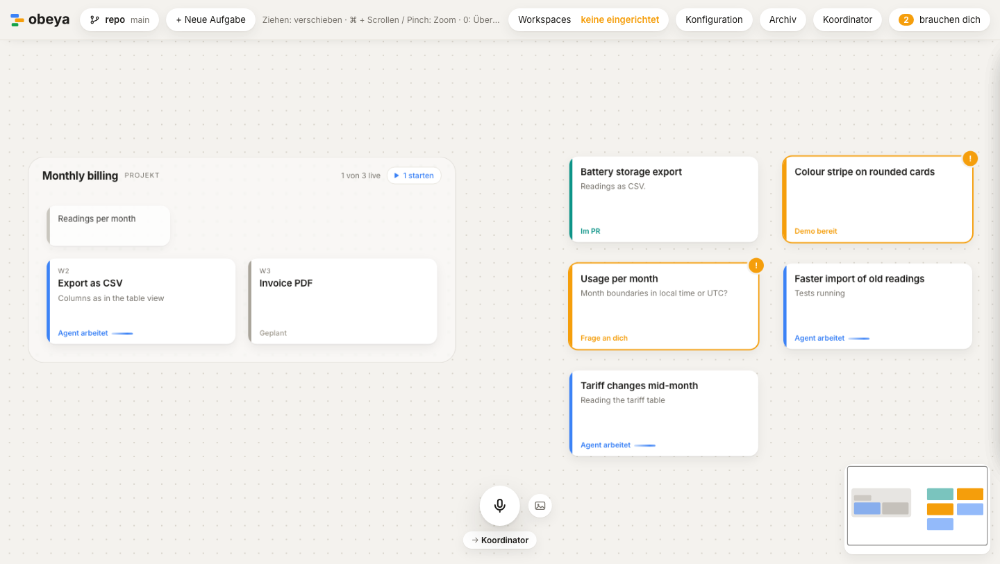

<h1>
  <picture>
    <source media="(prefers-color-scheme: dark)" srcset="src/ui/logo/wordmark-dark.svg">
    
  </picture>
</h1>

A spatial workspace for directing AI coding agents the way an engineering director directs a
team. Every task and every project is a card on one canvas. Agents do the work in the
background; you keep every essential decision — made by voice, from a narrated demo of the
finished work, without reading code or cycling through terminals. At your desk or from your phone.

*Obeya* is Japanese for "big room": in lean management, the room where every project hangs
visibly on the walls. More on [obeya.si](https://obeya.si).

<a href="https://obeya.si/#film"></a>

The video shows Obeya at work in four and a half minutes: an idea is said into the microphone, an
agent builds it and records its demo, and the approval lands it on `main` ([watch on
obeya.si](https://obeya.si/#film), with captions and chapters).

See every feature in action: each change to Obeya comes with the demo its agent recorded, on
[demos.obeya.si](https://demos.obeya.si).

## How it works

Each card gets its own agent (Claude Code) in its own clone or worktree of your repository, on
this machine or on another one reached over SSH. The agent asks on the card when it needs a
decision and hands over with a demo: a narrated screen recording of the change, or a page to look
at when the result is a layout or variants side by side. You approve it or say what to change, also
about one moment of the video: what you type or say while it stands there goes to the agent with
that frame and the narration's sentence. Approved work lands on `main` or goes out as a pull
request on GitHub (GitHub Enterprise too), Forgejo or Gitea (Codeberg, say) that Obeya carries to
the merge, or up to it where your team merges itself; beside the branch the card shows how large the change is, and a
click shows the diff. A report or another file the agent made for you shows beside its
conversation. "Share" puts a demo on a page of its own on your repository's demo
site, for colleagues to watch; the site can also take every approved demo by itself. A repository
without a site of its own shares on a personal one of yours, which Obeya sets up on GitHub Pages
or Cloudflare with one button. A pull request someone else opened gets a card on your word:
its agent reads the diff before anything of it runs, reviews it, records a demo before and after,
and your approval merges it.

You talk to Obeya itself, spoken or typed: it takes your instructions, queues cards whose changes
would collide, cuts large ones into parallel packages and learns your preferences. An idea is
thought through on its card with an agent of its own, which keeps a brief of variants and open
questions and can have throwaway prototypes built; deciding builds it, in your repository or in a
new one Obeya creates for it, or plans it as a project,
or splits off the part that is settled as a task while the rest stays open. Larger work is planned
in plan docs, in the repository or in a folder of your own beside it, which show as projects with
a card per workstream and a project agent to ask about the plan. Each product you build gets a canvas of its own, over one repository or
several, and one Obeya runs them all. The bar shows how much of your Claude plan's session and week
is used.



## On your phone

Away from the desk, your phone shows what waits for you across all your canvases, and what is
running. Watch a demo and approve it, answer a question, or hold the microphone and say a new
task. A notification tells you when a card needs you.

<p>
  
  &nbsp;
  
</p>

Obeya keeps running on your computer, and the phone reaches it over your own private network:
Tailscale or another VPN. Nothing goes through a service of ours, and nothing is open to the
internet. How to connect a phone is [below](#connecting-a-phone).

**Status:** early, but in daily use. Obeya is built with Obeya, and it's used to build commercial
software. It speaks English and German. How it works and why is in
[`docs/design.md`](docs/design.md).

## Download

| | |
|---|---|
| macOS | [Apple Silicon](https://github.com/sadilek/obeya/releases/latest/download/Obeya-macOS-arm64.dmg) · [Intel](https://github.com/sadilek/obeya/releases/latest/download/Obeya-macOS-x64.dmg) (DMG) |
| Windows | [Installer](https://github.com/sadilek/obeya/releases/latest/download/Obeya-Windows-x64-setup.exe) (x64) |
| Linux | AppImage for [x64](https://github.com/sadilek/obeya/releases/latest/download/Obeya-Linux-x86_64.AppImage) · [arm64](https://github.com/sadilek/obeya/releases/latest/download/Obeya-Linux-aarch64.AppImage), .deb for [x64](https://github.com/sadilek/obeya/releases/latest/download/obeya_amd64.deb) · [arm64](https://github.com/sadilek/obeya/releases/latest/download/obeya_arm64.deb) |

The app needs neither Bun nor a checkout. On its first start it checks the machine: what Obeya
needs ([Claude Code](https://claude.com/claude-code) with your login, git), what can wait (the
[GitHub CLI](https://cli.github.com) for pull requests, voice, demos). It installs what it can
without admin rights and shows the command for the rest, then opens your first canvas on one of
your repositories. The Windows installer is not signed yet (applied for at the SignPath
Foundation): SmartScreen warns about it, and "More info" → "Run anyway" goes on ([code signing
policy](https://obeya.si/code-signing/)). On Linux, make the AppImage executable (`chmod +x`) first.
The app keeps itself up to date: a new release shows in its bar, and installing it waits until
the agents have paused, then the app restarts with it (a .deb is updated by installing the next
one).

On the canvas, double-click to write a task, then start its agent ("Start agent"). The card
shows what the agent is doing; when it waits for you ("need you" in the top bar), open it to
answer a question or watch the demo and approve it ("Approve"). Hold Space to say what to do
instead of typing; `?` lists every key.

### Connecting a phone

1. Install [Tailscale](https://tailscale.com) on the computer and on the phone, both logged in as
   the same account.
2. In Obeya's "Configuration", under "Other devices", turn on "Reachable from other devices". The
   section says what the network still lacks (Tailscale not running, HTTPS off in the tailnet, …),
   each with its one step.
3. "Connect a phone" shows a QR code. Scan it with the phone: that pairs it, and the address opens
   the phone view from then on.
4. Turn on notifications on the phone. On an iPhone this needs Obeya on the home screen first
   ("Share" → "Add to Home Screen", then open it from there).

Instead of Tailscale, Obeya can listen on an address of another VPN ("At an address"). That is
plain HTTP, so the phone's browser allows neither the microphone nor notifications there. Pairing
and removing devices happen on the computer only. The phone reaches Obeya only while the computer
is awake: "Keep this computer awake" beside the setting holds off sleep while an agent works, or
always (a closed laptop lid still sends it to sleep).

## From source

Obeya is developed this way: started from a checkout, it updates itself whenever the checkout
moves to new code. When `origin` has new commits, the bar says so and offers to `git pull` them.

- [Bun](https://bun.sh) 1.3.14 or newer (on Linux, older 1.3 releases can hang the canvas).
- [Claude Code](https://claude.com/claude-code), installed and logged in. Obeya starts it for every agent;
  the agents run on your own login.
- git, and the [GitHub CLI](https://cli.github.com) (`gh`, logged in) for repositories whose work
  lands through pull requests.
- For demos: Node.js 22.18 or newer, a Chromium browser, ffmpeg and uv. "Configuration" →
  "Demos" shows what is missing and how to install it; see [`docs/demo-setup.md`](docs/demo-setup.md).
- For voice: ffmpeg and uv. Parakeet hears what you say, on the CPU of any machine (a fraction
  of a second per command). "Configuration" → "Voice input" shows what is missing, installs the
  rest and measures how fast it is; where it is too slow, it offers a cloud service instead (Groq
  for free, Mistral, or any OpenAI-compatible endpoint). Everything else works without it.

```bash
git clone https://github.com/sadilek/obeya.git
cd obeya
bun install
bun start                       # then open the link it prints: it signs the browser in
```

The first start without canvases shows the same setup as the app. `bun run build` compiles the
single-file server and `bun run build:app` the app for the machine it runs on.

### Running

```bash
bun start ~/dev/shop ~/dev/shop-web --name Shop   # one canvas, two repositories
bun start                       # the canvases in ~/.obeya/canvases.json (see src/server/main.ts)
bun start --config other.json   # those of another file
bun run dev ~/dev/shop          # same, with hot reload
bun test --parallel && bun run typecheck
```

Options: `--port <n>` (or `OBEYA_PORT`), `--workspace <path>` (repeatable) or `--clones <n>` to
have workers use clones instead of a worktree per card, `--permission-mode <mode>` for workers
(default `auto`). Data and worktrees live in `~/.obeya/` (`OBEYA_HOME` to move it), the same for
the app and a checkout, so canvases, settings, voices, models and paired phones carry over between
them. One Obeya runs per home: starting the app while a checkout's Obeya runs opens a window on
it, and `bun start` while the app runs says where it runs, with a new link that signs another
browser in. An Obeya older than the one that last ran on the home (an app not yet updated after a
newer checkout) leaves the database alone and says to update. Workers run on the Claude Code login
of the machine. The canvases and their repositories can be seen and changed in the app
("Configuration") or by telling Obeya; saving writes `canvases.json`, and the running canvases take
it over at once (started with repositories on the command line, Obeya restarts with the file).

Voice runs Parakeet (`onnx-asr`) in a sidecar through `uv run`, or in a Python of your own with that
package (`OBEYA_WHISPER_PYTHON=/path/to/python`). `OBEYA_WHISPER_BACKEND` chooses Whisper instead:
`mlx`, `faster`, or `whisper` for this platform's. Demos are recorded by the skill in
`plugin/`, which Obeya gives its workers; what a machine needs for them (Node, a browser, ffmpeg,
uv, a voice) is in [`docs/demo-setup.md`](docs/demo-setup.md).

`bun run app install` installs Obeya from the checkout as an app, "Obeya (checkout)", that you
start like any other (`~/Applications` on a Mac, the Start menu on Windows, the applications menu on
Linux); `bun run app` runs it from the terminal instead. It needs Rust, on Linux also WebKitGTK's
development files; the first build takes a few minutes. The app runs the checkout's code and follows
it as `bun start` does, and builds itself anew when its own part (`app/`) changes, so it is
installed once.

### Workers on other machines

A repository's workers can also run on other machines, reached over SSH: "Configuration" lists them
per repository (the SSH target, the directory for the clones, how many clones and how many agents at
once). Obeya clones the repository there itself, and a new card goes there once this machine has no
free slot. The other machine needs git, Claude Code and what the repository's own work needs; the
logins go along with each start (Claude's from `claude setup-token`, saved as `claude-token` in
Obeya's home) and are not left there. Demos recorded there come back to this machine and are
narrated by its voice. How it works is under "Hosts" in
[`docs/design/agents-and-workspaces.md`](docs/design/agents-and-workspaces.md).

### Setting up a repository

Obeya works on any git repository, and on a folder that is to stay without git (a document
archive in a cloud drive, say): there cards work in the folder itself, each listing what it
changed, and "Discard changes" puts it back. How a project's app starts, which checks a change must pass,
how approved work lands and how a demo is recorded, the repository says in its settings,
`.obeya/settings.json`; [`docs/settings.md`](docs/settings.md) describes them. "Configuration" shows
them, changes them for one machine and takes them over into the repository for everyone, and offers
a card whose agent writes them for a repository that has none. Commands a repository brings along
(in these settings and in its Claude Code configuration) run only once you have trusted them, and
after a change only once you have trusted them again.

## Contributing

How Obeya itself is built, with Obeya, is in [`CONTRIBUTING.md`](CONTRIBUTING.md). A wish or a bug
can be reported from inside Obeya ("Report a wish or a bug" in "Configuration"): it drafts a GitHub
issue for you to send.

Issues and pull requests are welcome.

## License

[MIT](LICENSE), © Daniel Sadilek.
